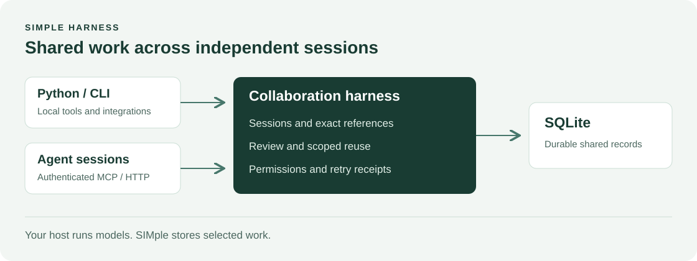
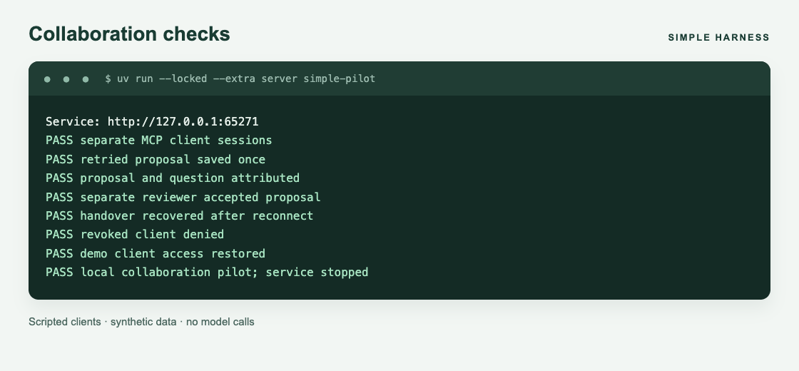

# SIMple Harness

Shared work for people and their agents.

SIMple saves findings, decisions and handovers so someone else can pick up the work in a new session. Each entry records who wrote it, which sources they used and which versions of earlier work it relies on.

Use it from Python, the command line or an optional Model Context Protocol (MCP) service. You don't need a model account. The core uses the Python standard library and SQLite.



**Experimental alpha.** The API may change. We test the collaboration rules, but we haven't yet shown that SIMple saves time or is easy for two people to use together. A shared Markdown file may be all your team needs.

## Try it: what happens when earlier work changes?

Suppose someone fixes a calculation and a reviewer approves it for reuse. Later, one of the inputs it relies on changes. Is the earlier advice still safe to use?

SIMple leaves it out of new context requests until it has been checked and approved again. It also leaves out instructions that depend on that advice.

This example uses made-up data. Install [uv](https://docs.astral.sh/uv/) and use Python 3.12:

```sh
git clone https://github.com/aobeysekara/simple-harness.git
cd simple-harness
uv sync --locked --python 3.12
uv run --locked python -m examples.reuse_comparison --directory .simple/first-comparison
```

The calculation starts by wrongly counting cancelled issues as work. The script runs a test that catches the mistake, applies the fix, and approves two pieces of advice: a rule for this project and instructions that use it. It then changes the recorded version of the input contract—the rules for interpreting the data.

| What happened | Advice SIMple allows | Advice the updated Markdown allows | Advice still shown in an untouched copy |
|---|---:|---:|---:|
| Both items tested and approved | 2 | 2 | 2 |
| Input contract version changed | 0 | 0 | 2 |
| Fix tested again, review still pending | 0 | 0 | 2 |
| Both items checked and approved again | 2 | 2 | 2 |

**Keeping Markdown up to date can give the same result.** In this example, the script updates the Markdown handover to say the advice must not be used. SIMple applies that rule when someone asks for context. The untouched copy shows what happens if nobody updates the handover; it isn't the maintained Markdown comparison.

The files under `.simple/first-comparison/comparison/` show the handovers at each step. The JSON files under `.simple/first-comparison/operator/` show what SIMple returned. Use a new output directory each time.

The script performs all the reviews and Markdown edits. It changes the recorded contract version, but keeps the calculation rules the same. This shows how SIMple handles a recorded change. It doesn't show that agents work better, and SIMple doesn't watch outside files for changes or take back advice an agent has already read.

The [walkthrough](docs/reuse-demonstration.md) explains the output and suggests how to try this with another engineer. For a smaller example of saving and picking up work, run `uv run --locked python examples/reading_group.py`.

## Try separate clients

This script connects separate clients to the service, each with its own credentials:

```sh
uv sync --locked --extra server --python 3.12
uv run --locked --extra server simple-pilot
```



This screenshot shows output from a real run of the script. The script checks the service; it doesn't involve live agents or human reviewers.

## How it works

1. Start a session with `open_session`.
2. Ask for context for a goal. Supply the facts you know and a size limit in bytes.
3. Share useful work, naming its sources and the exact versions of other entries it uses.
4. Refresh the context as you work, then leave a handover when you finish.

Opening a session doesn't load the whole history. SIMple only returns work you have permission to read. It rejects new submissions that refer to outdated versions. If you repeat an identical request that already succeeded, it returns the saved result after checking your current access.

To make a correction reusable, its local tests must pass and a different reviewer must approve both the advice and where it applies. SIMple won't assume it applies when required facts are missing. A rule for one project doesn't automatically apply to another.

| I want to… | Guide |
|---|---|
| Use it from Python | [Python API](docs/python-api.md) |
| Connect clients | [Service and MCP setup](docs/shared-service.md) |
| Test and approve a correction | [Correction and reuse](docs/correction-reuse.md) |
| Understand the code and its limits | [Architecture](docs/architecture.md) |

## Limits and contributing

You must trust whoever runs the database. Clients use their own access tokens to connect through the service. SIMple checks permissions on the sources you name; it cannot detect sensitive information copied from a source you haven't named. Review records someone's judgement, and tests check specific cases. Neither guarantees that advice is always correct.

CI runs on Linux with Python 3.12. Local test replay needs Unix file locking; ordinary CLI commands don't. We haven't verified Windows support. There is no published PyPI package or hosted service.

See [CONTRIBUTING.md](CONTRIBUTING.md) to suggest changes, [SECURITY.md](SECURITY.md) to report a security problem, and the [build guide](docs/alpha-release.md) to build a package locally.

MIT licensed. See [LICENSE](LICENSE).
