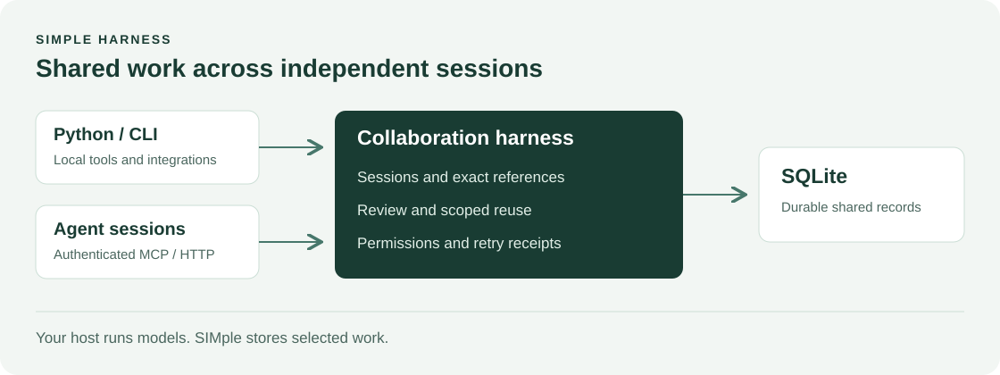

# Architecture

The harness owns shared records and collaboration rules. Existing clients own their conversations, model calls and execution.

| Layer | Responsibility |
|---|---|
| Domain | Records, errors and input contracts |
| Application | Sessions, access checks, exact references, review, retries and context selection |
| Repository port | Detached records, ordered revisions and atomic transactions |
| SQLite adapter | Local persistence |
| CLI and HTTP/MCP adapters | Input validation, authentication and application calls |

Dependencies point inward. The application accepts a repository; it does not import SQLite or transport libraries. The standard-library core needs no model SDK. The optional service adds its own dependencies.

## Collaboration contract

Sessions bind an authenticated user and client to a workspace task. Disconnection does not close a session. Ending one does not complete the task.

New dependencies name an exact contribution revision. Stale references conflict. Amendments retain history and reset review state. An exact committed retry returns its recorded result after current access checks. Records, history, receipts and audits commit together.

Reuse requires declared scope, passing trusted replay and a different reviewer's approval. Validation identifies semantic content, so a review-only revision does not invalidate its own checks. Content or dependency changes require reconsideration.

Context selection uses exact goal tags, known facts and declared relationships. It applies permissions before selection and returns complete items within a JSON byte budget. It reports insufficient context instead of clipping qualifications or loading all history.

## Operating limits

SQLite serialises transactions. Several reads scan history. Policy invalidation is global, and receipts, cursors and audits have no expiry. This is intended for small alpha evaluations, without a production capacity claim.

There is no agent runtime, semantic search service, automatic transcript ingestion or automatic promotion. See the [security boundaries](../SECURITY.md) and [Python API](python-api.md).
