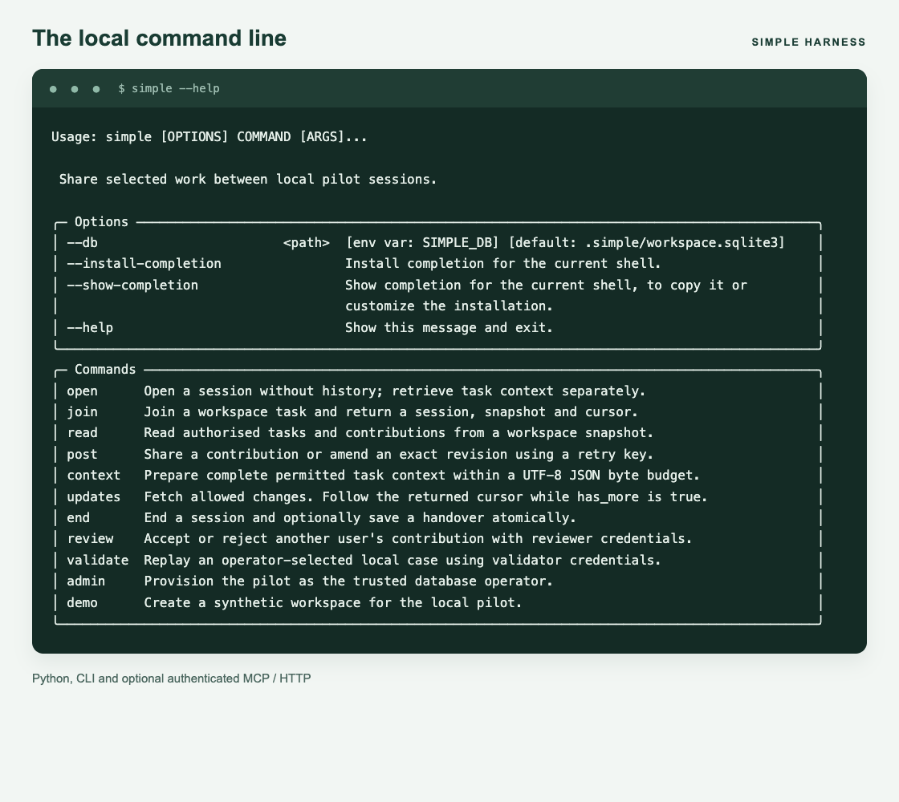

# Python API

The package exports `Harness`, `Administration`, `authenticate`, `Repository` and the application errors. Record types live in `simple_framework.domain`. Storage adapters use explicit imports.

Use a new database path for this example:

```python
from pathlib import Path

from simple_framework import Administration, Harness, authenticate
from simple_framework.sqlite import SQLiteRepository

with SQLiteRepository(Path(".simple/project.sqlite3")) as repository:
    admin = Administration(repository)
    admin.create_workspace("project", "Release planning")
    admin.create_task("project", "checks", "Agree release checks")
    token = admin.register_client("alice", "python-client", "local", "contributor")
    admin.set_membership("project", "alice", True)

    caller = authenticate(repository, token)
    harness = Harness(repository)
    session = harness.open_session(caller, "project", "checks", request_id="open-1")
    update = harness.post_update(
        caller,
        session.id,
        kind="question",
        text="Which checks must pass before release?",
        request_id="question-1",
        sources=[],
    )
    packet = harness.prepare_context(caller, "project", "checks", goal="release", facts={})
    harness.end_session(caller, session.id, request_id="end-1")
    print(update.id, packet.status)
```

Keep the token private. An empty source list declares original work. For derived work, supply registered source IDs and `derived_from=[{"update_id": "ID", "revision": N}]` using the revision actually read.

Each operation owns its transaction. Do not wrap application calls in a repository transaction. The local operator controls the database; independent clients should use the [service](shared-service.md).

## Errors and types

Catch `AccessDenied` for permission failures, `Conflict` for stale revisions or changed retries, and `InvalidRequest` for invalid input. All inherit `HarnessError`.

Retry an uncertain write with identical arguments and its original request ID. For a stale new submission, refresh and reconsider first. A conflict is not permission to replace the request ID blindly.

The package includes `py.typed` for downstream type checking. Modules beginning with `_` are private implementation details. The public API remains experimental.

The CLI exposes the same application operations:



Screenshot of locally rendered `simple --help` output. See the [service guide](shared-service.md) for remote clients.
