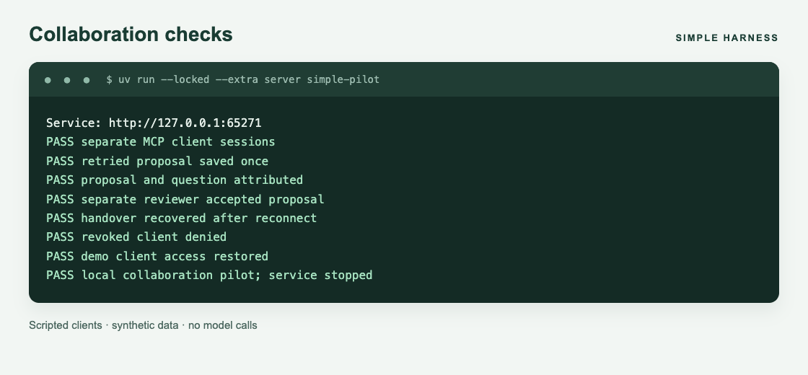

# Connect clients

The service owns the database. Each client receives its own token and connects through HTTP or MCP.

## Start locally

```sh
uv sync --locked --extra server --python 3.12
uv run --locked simple demo setup --directory .simple/demo
uv run --locked --extra server simple-serve --db .simple/demo/workspace.sqlite3
```

Setup creates workspace `reading`, task `first-week`, and separate Alice, Bob and reviewer token files. It refuses an existing directory. The service listens at `http://127.0.0.1:8000/mcp` by default.

Load only the participant's token into the terminal that launches their client:

```sh
export SIMPLE_TOKEN="$(cat .simple/demo/alice.token)"
```

Use `bob.token` for the other participant. Keep `reviewer.token` out of agent environments. Do not copy the database or token directory into a shared workspace.

## Configure MCP

The repository includes [Codex TOML](../examples/clients/codex.toml) and [Claude Code JSON](../examples/clients/claude.mcp.json) examples. Both use an environment variable rather than an embedded token. For other hosts, configure an authenticated HTTP MCP connection to the same endpoint.

Give clients the [workspace instructions](../examples/clients/WORKFLOW.md). For bounded work:

1. Call `open_session` with the workspace, task and a request ID.
2. Call `prepare_context` with the task's goal, known facts and a byte budget.
3. Post selected contributions using exact references.
4. Refresh context at checkpoints and leave a handover through `end_session`.

The server also exposes `join_workspace`, `read_workspace` and `get_updates` when history is explicitly needed. Session opening does not require paging through history. Clients discover operation schemas through MCP.

HTTP uses the same operation names at `POST /api/OPERATION`. Include `Authorization: Bearer TOKEN`. Review is separate: `POST /api/review_update` requires a different user's reviewer credential and is not an agent tool.

## Separate machines

Use an encrypted tunnel to the operator's loopback service, or an HTTPS reverse proxy. For example:

```sh
ssh -N -L 8000:127.0.0.1:8000 user@service-machine
```

Give the tunnel account forwarding access without database access. Each participant still needs a separate harness token.

For an HTTPS proxy, start the service with `--public-url https://simple.example.org`. Preserve Host and Authorization headers. The operator manages certificates and proxy configuration.

## Check the connection

```sh
uv run --locked --extra server simple-pilot
```



The screenshot renders output from a real local run. The pilot uses two scripted clients, review, retries, reconnection and revocation. It stops its temporary service afterwards. It does not run models or demonstrate two-person usability.

A withheld response may follow a committed write. Retry identical arguments with the same request ID. If permissions change, refresh context; if authentication fails, stop until access is restored. See [SECURITY.md](../SECURITY.md).
